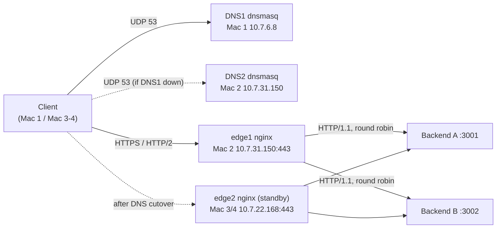

# Private Network Service Platform

Computer Networks course project: a private service reachable at `https://app.teamX.test` across three Macs on the college LAN. It uses private DNS, TLS termination and load balancing at an nginx edge, and two REST backends. Phase 2 adds backup DNS, TTL-controlled cutover, backend isolation, HA failover, a standby edge, and a layer-by-layer troubleshooting tool.

> *The application stays simple — the network is the project.*

## Project members

| Name | Enrollment | Machine | Responsibilities |
| --- | --- | --- | --- |
| **Antik Mondal** (lead) | 2401010084 | Mac 3/4 | Backend A (:3001) + Backend B (:3002), standby edge (Ext E), backend firewall (Ext C), Wireshark evidence |
| **Vansh Panwar** | 2401010494 | Mac 2 | nginx edge: reverse proxy, TLS, load balancing, HA (Ext D); backup DNS (Ext A) |
| **Tanmay Singh** | 2401010476 | Mac 1 | Primary private DNS (dnsmasq), records and TTL (Ext B), test client |

## Network inventory (23 Nov 2026, LAN 10.7.0.0/19, gateway 10.7.0.1)

| Mac | IP | Services |
| --- | --- | --- |
| Mac 1 (Tanmay) | `10.7.6.8` | dnsmasq :53 (primary) |
| Mac 2 (Vansh) | `10.7.31.150` | nginx :80/:443 (edge1), dnsmasq :53 (backup) |
| Mac 3/4 (Antik) | `10.7.22.168` | Flask :3001 (A), :3002 (B), nginx :443 (edge2 standby), pf |

`app.teamX.test` and `api.teamX.test` → `10.7.31.150`, TTL 30 s. College Wi-Fi uses DHCP: the source of truth is [`team/team.env`](team/team.env). See [docs/architecture.md](docs/architecture.md) for diagrams and the full inventory.



## Quick start (operator Mac)

```bash
scripts/get-my-ip.sh          # on each Mac - update team/team.env if anything changed
scripts/deploy.sh             # render + push configs to all Macs, start everything, show status
scripts/smoke-test.sh         # DNS -> HTTPS -> load balancing -> caching
scripts/diagnose.sh           # layer-by-layer health / fault isolation
```

One-time per client Mac (needs your password): `sudo scripts/phase2/client-setup.sh`

## Tests and evidence

```bash
scripts/phase2/run-tests.sh p1        # Phase 1 regression
scripts/phase2/run-tests.sh p1fail    # Phase 1 failure scenarios
scripts/phase2/run-tests.sh extA      # backup DNS          (B, C, D, E likewise)
scripts/phase2/fault-drills.sh        # Extension F practice drills
scripts/phase2/capture.sh flow        # Wireshark capture of DNS -> TCP -> TLS -> HTTP
```

Results: [evidence/phase2/](evidence/phase2/README.md). Phase 1 evidence: [evidence/phase1/](evidence/phase1/README.md).

## Repository layout

```text
team/team.env                  inventory: every IP / role (source of truth)
backend/app.py                 Flask REST backend (same file runs as A and B)
dnsmasq/dnsmasq.conf.template  DNS config (rendered for Mac 1 and Mac 2)
nginx/nginx.conf.template      edge config (rendered for edge1 and edge2)
firewall/pf-backend-isolation.conf.template   Extension C rules
config/rendered/               the configs exactly as deployed
tls/                           team CA cert + edge cert (keys are never committed)
scripts/
  render-configs.sh  deploy.sh  diagnose.sh  get-my-ip.sh  smoke-test.sh
  phase2/cn.sh               per-node control (dns / dns-record / edge / backend)
  phase2/client-setup.sh     client DNS + CA trust (sudo)
  phase2/firewall.sh         pf apply / status / rollback (sudo)
  phase2/run-tests.sh        automated tests -> evidence/phase2/logs
  phase2/fault-drills.sh     Extension F drills
  phase2/capture.sh          packet captures -> evidence/phase2/captures
docs/                          architecture, runbook, report, viva prep, Phase 1 docs
evidence/phase1, phase2        logs, captures, screenshots
```

## Documentation

- **[Presentation Guide](docs/presentation-guide.md)**: the whole project in plain language + live demo script
- [Phase 2 Report](docs/phase2-report.md): what changed, test results, troubleshooting, learning summary
- [Phase 2 Runbook](docs/phase2-runbook.md): setup, final demo sequence (steps 1–11), rollback
- [Architecture](docs/architecture.md): topology, IP/service table, request flow, layer map
- [Viva prep](docs/viva-prep.md)
- [TLS setup](docs/tls-setup.md) · [DNS guide](dnsmasq/README.md) · [Phase 1 playbook](docs/project-playbook-and-troubleshooting.md) · [Phase 1 demo commands](docs/demo-commands.md)
