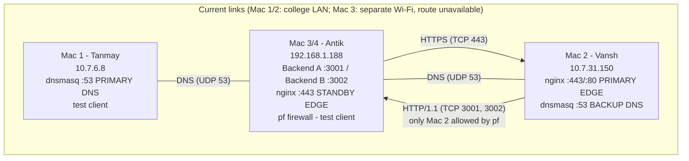
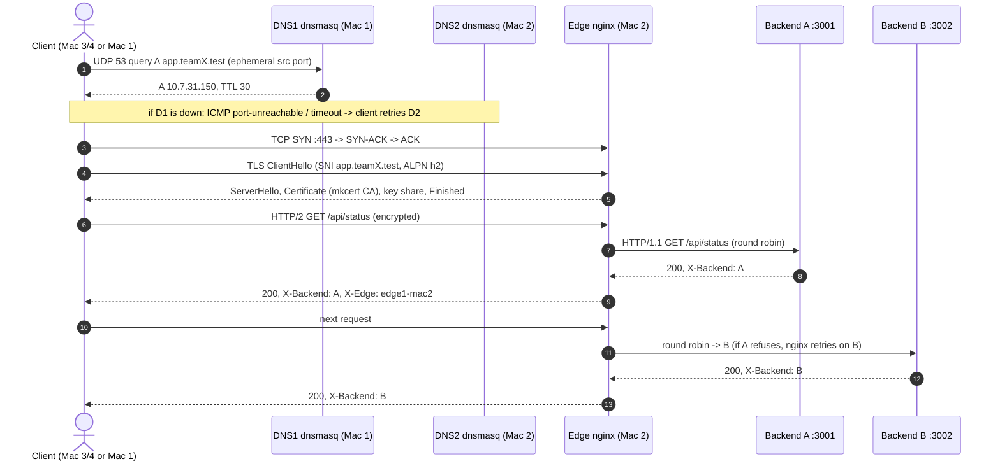

# Architecture & Network Design (Phase 1 + Phase 2)

> Updated 25 Nov 2026. Mac 1 and Mac 2 remain on the college LAN; Mac 3 is currently on a different Wi-Fi network. Mac 2 cannot currently initiate connections to Mac 3's backend ports. Rejoin the same LAN or establish a route/VPN before the demo. `team/team.env` is the source of truth.

## Project members

| Name | Enrollment | Machine | Phase 1 role | Added in Phase 2 |
| --- | --- | --- | --- | --- |
| **Tanmay Singh** | `2401010476` | Mac 1 | Private DNS server (dnsmasq) + test client | — |
| **Vansh Panwar** | `2401010494` | Mac 2 | Edge reverse proxy, TLS termination, load balancer (nginx) | **Backup DNS resolver** (Ext A) |
| **Antik Mondal** (lead) | `2401010084` | Mac 3/4 | Backend A (:3001) and Backend B (:3002) + test client | **Standby edge** (Ext E), **backend firewall** (Ext C) |

We are a 3-person team, so as the brief allows, Mac 3 and Mac 4 are combined on one laptop: two separate backend processes on two separate ports.

## Topology

## IP and service inventory

| Mac | Hostname | Interface | IPv4 / prefix | Gateway | MAC address | Listening services |
| --- | --- | --- | --- | --- | --- | --- |
| Mac 1 | Tanmays-MacBook-Pro-2 | en0 (Wi-Fi) | 10.7.6.8/19 | 10.7.0.1 | 12:14:be:79:50:fe | dnsmasq UDP/TCP 53 |
| Mac 2 | MacBook-Pro-13 | en0 (Wi-Fi) | 10.7.31.150/19 | 10.7.0.1 | 46:1b:28:2c:93:f0 | nginx TCP 80, 443; dnsmasq UDP/TCP 53 |
| Mac 3/4 | Antiks-MacBook-Pro | en0 (Wi-Fi) | 192.168.1.188/24 | 192.168.1.1 | current private Wi-Fi address | Flask TCP 3001, 3002; nginx TCP 80, 443 |

(The MAC addresses are macOS private Wi-Fi addresses, so they are fixed per network but differ from the hardware address.)

### DNS records (served identically by both resolvers)

| Name | Type | Value | TTL |
| --- | --- | --- | --- |
| `app.teamX.test` | A | `10.7.31.150` (edge1). Moved to `192.168.1.188` (edge2) during Ext E | 30 s |
| `api.teamX.test` | A | same as app | 30 s |
| any other `*.teamX.test` | — | NXDOMAIN (`local=/teamX.test/`, never forwarded) | — |
| everything else | — | forwarded to 10.5.7.1 (college DNS), then 8.8.8.8 | upstream |

## Cloud equivalents

| Our component | Cloud equivalent |
| --- | --- |
| dnsmasq primary + backup with short TTL | Route 53 hosted zone (anycast name servers, low TTL for cutover) |
| nginx edge with TLS termination and round robin | AWS ALB / GCP HTTPS Load Balancer |
| Passive health checks + `proxy_next_upstream` | ALB target-group health checks |
| Standby edge + DNS cutover | Route 53 failover / weighted records, blue-green deployment |
| pf rule "only the edge reaches :3001/:3002" | Security group allowing the backend port only from the LB's security group |

## Request flow (one client request, every layer)

## Protocol layer map

| Layer (TCP/IP / OSI) | Protocol | Where in our system | Port |
| --- | --- | --- | --- |
| Application (7) | DNS | client → dnsmasq | UDP 53 (TCP 53 for large answers) |
| Application (7) | HTTP/2, HTTP/1.1, REST/JSON | client → nginx (h2); nginx → Flask (HTTP/1.1) | 443 / 3001, 3002 |
| Session/Presentation (5/6) | TLS 1.2 / 1.3 | terminated on nginx; traffic behind the edge is plain HTTP on the trusted LAN | 443 |
| Transport (4) | TCP, UDP | TCP for HTTP(S), UDP for DNS | ephemeral → well-known |
| Network (3) | IPv4, ICMP | 10.7.0.0/19; ICMP port-unreachable is what tells a client "DNS1 is down" | — |
| Link (2) | 802.11 Wi-Fi / Ethernet framing, ARP | en0 | — |

## What changed in Phase 2

| Area | Phase 1 | Phase 2 |
| --- | --- | --- |
| DNS | one dnsmasq, `address=` records (TTL 0) | two dnsmasq resolvers (Mac 1 + Mac 2), records in a reloadable hosts file, **TTL 30 s**, project zone never forwarded |
| Client resolver | single DNS server (or `/etc/resolver/test`) | both resolvers listed: `10.7.6.8, 10.7.31.150` |
| Edge | nginx :443, HTTP/1.1 only, no failover tuning | HTTP/2, :80→:443 redirect, `max_fails=1 fail_timeout=10s`, `proxy_next_upstream` retry, 2 s connect timeout, `X-Edge` header, upstream access log |
| Edge redundancy | none | warm standby nginx on Mac 3/4 with the same config and certificate; cutover by DNS |
| Backend exposure | ports 3001/3002 open to the whole LAN | pf anchor on Mac 3/4: only Mac 2 may connect; rollback script |
| Operations | manual edits, IPs hard-coded in 5 places | one `team/team.env` → `render-configs.sh` → `deploy.sh`; `cn.sh` per-node control; `diagnose.sh` layer-by-layer |

## Remaining single points of failure

1. **The edge IP.** DNS cutover moves traffic to the standby, but clients that cached the old answer keep hitting the old edge for up to one TTL (30 s). To remove that: a floating/virtual IP shared by both edges (VRRP/keepalived, CARP), or several A records with health-checked DNS (Route 53 failover). In the cloud, a managed load balancer runs on many nodes behind one name.
2. **The backend host.** Both backends run on Mac 3/4, so losing that laptop takes both down (502). Fix: put Backend B on a fourth Mac.
3. **Manual zone sync.** Both resolvers are updated by the same command, not by zone transfer. A real primary/secondary pair would use AXFR/IXFR with NOTIFY.
